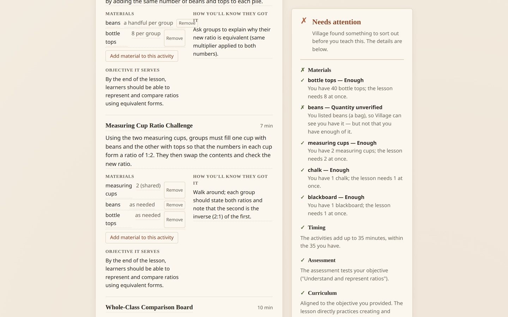

# Village

Lesson plans that fit the room you actually have.



*The lesson on the left. On the right, the checker that read it: every
material, the timings, the assessment, the curriculum line — and what it
could not verify.*

**Watch it work (1:60):** <https://github.com/Udeibom/village/releases/download/demo-1/village-demo-v3.mp4>

**Try it out:** No account or login required. Run locally with `npm install && npm run dev`, open `http://localhost:5173`. The app runs offline once loaded; only writing a new lesson needs a connection.

This was built for a classroom like the one it took to build it: a Kenyan
Primary 6 class, 40 pupils, 35 minutes, no projector, no printing, no
internet in the room. Bottle tops, beans, a few measuring cups.

## Built with the Build With AI: Basics skill pack

This project was planned and built using the Build With AI: Basics skill pack (scope → PRD → spec → build → ship). The planning documents are kept in the repository:

- [scope.md](devpost/scope.md) — the idea, narrowed to one thing
- [prd.md](devpost/prd.md) — what it does, for whom
- [spec.md](devpost/spec.md) — how it is built
- [checklist.md](devpost/checklist.md) — the build, slice by slice
- [app-map.html](devpost/app-map.html) — the app on one page

MIT licensed.

Village takes a lesson request (grade, subject, objective, your curriculum
standard) and your classroom reality (class size, duration, constraints,
materials with quantities), then builds a lesson around what you have — and
checks its own work before it calls the lesson ready.

The point is the check. An AI will happily write a lesson that needs a
projector you do not have. Village does not: the lesson is written, then a
plain-JavaScript checker compares every material the lesson asks for against
the list you typed, adds up the timings, and confirms that an assessment
activity actually tests your objective. If something does not add up, the
lesson is rebuilt around what you do have.

## Running it

You need Node 18 or newer and a free Groq API key.

```bash
npm install
cp .env.example .env      # then paste your key into .env
npm run dev
```

Open <http://localhost:5173>. `npm run dev` starts two processes: the React
page on 5173 and the local server on 3001, which holds the API key so the
browser never sees it. The page talks to the server through Vite's `/api`
proxy.

Your classroom is kept on your own device, not on a server: the materials you
listed, the lessons you taught and how they went, and your curriculum
extract. Nothing is sent anywhere, and "Forget this classroom" clears it.

`.env` holds two things:

```
GROQ_API_KEY=your-key-here
GROQ_MODEL=openai/gpt-oss-120b
```

The key stays on the server. The model name is yours to change if you want a
different one; the app checks the lesson either way, so a different model
changes the wording, not the guarantee.

## What you can do with it

1. **Ask for a lesson.** Grade, subject, topic, and the curriculum objective
   you are covering. The Generate button stays disabled until there is
   something to generate from.
2. **Say what you have.** Class size, how long you have, anything that limits
   the lesson, and your materials with quantities. A material with no count is
   treated as "not verified", not as "plenty".
3. **Paste your curriculum.** If you have the scheme-of-work line this lesson
   covers, Village searches *your* document for it and quotes the line it
   found. With a document in front of it, the document decides — not the
   model's opinion of itself.
4. **Read the verdict.** The panel on the right says whether the lesson can be
   taught with what is on the table, names every material that does not line
   up, adds up the timings, and checks that the assessment tests your
   objective.
5. **Change your mind.** Edit any line of the lesson, add a material to an
   activity, or change your inventory. The lesson is checked again straight
   away, and the verdict follows your edit.
6. **Say how it went.** Mark the lesson as worked, changed or failed. That
   goes into your classroom's record, with the date and the class size.
7. **Plan the next one around what worked.** The next lesson offers the
   activity you proved, if the rules allow it: proved here, materials on the
   shelf, class size and lesson length close enough, same subject and year
   group. The rules are code, not the model's judgement.
8. **Hand it to a colleague.** A proven lesson exports as one small file. The
   file is a candidate, not a claim — it says "not yet proved here" until
   somebody teaches it and marks it as worked.
9. **Take it to the room.** Print / Export gives you a page with the lesson
   and the verdict and nothing else on it.

Village also works with no internet. The checker is a plain file that the
browser runs, so editing a lesson, re-checking it, reading your record and
printing all keep working when the connection does not. Only writing a *new*
lesson needs it, and it says so plainly.

## Checks

```bash
npm run verify         # 118 assertions on the rules (no browser, no API calls)
npm run browser-check  # 51 checks driving the real app in headless Chrome
npm run ai-check       # a live run against Groq (costs a little money)
```

`npm run browser-check` starts the dev server if it is not already running,
opens the app in headless Chrome, and asserts on what a teacher would see —
whether the Generate button is enabled, that a lesson renders, and what the
feasibility panel says. It runs the app in stub mode, so it never calls
Groq and never costs anything.

`npm run ai-check` is the other way around: it makes real calls and tells
you what the model actually produced, for a full inventory and a reduced one.

## How it is put together

```
shared/
  validate.js   the deterministic feasibility checker — plain functions, no AI.
                Lives here so the browser and the server run the same file.
  text.js       word normalisation and the four-letter matching keys
  curriculum.js finding the teacher's objective in the teacher's own document
server/
  index.js      Express: /api/generate, /api/check, the generate-check-rebuild loop
  grok.js       Groq client: prompts, strict JSON, parsing and shape checks
  rebuild.js    the loop: write, fit the timings, check, rebuild around what is missing
  check.js      re-check an edited lesson, without writing a new one
  timing.js     fitting the activity minutes onto the lesson's budget
  stub.js       a fixed lesson for the browser checks, so they cost nothing
src/
  App.jsx       page state
  components/   the form, the curriculum document, the lesson, the feasibility
                panel, the outcome strip, the classroom record, the print view
  lib/          form rules, the device store, the classroom record, the reuse
                rules, the lesson card, the in-browser checker
scripts/
  verify.js         assertions on the pure logic
  browser-check.js  headless-Chrome checks against the running app
  ai-check.js       a live run against Groq
```

The division of labour matters: **the AI describes, the code checks.** The
model is never asked to grade its own homework.

## What is the model, and what is the code

One file talks to the model: `server/grok.js`. It sends a prompt and reads
strict JSON back. That is the whole of the AI in Village, and what it produces
is prose — the words of the lesson.

Everything that decides whether the lesson can be taught is ordinary
JavaScript, in files you can read without a key and run without a network:

| The question | Who answers it |
| --- | --- |
| Is the model's answer the shape we asked for? | `server/grok.js` rejects it — the teacher gets an error, not half a lesson |
| Does the lesson need a material the teacher does not have, or more than they have? | `shared/validate.js`, against the list the teacher typed |
| Do the activities add up to the lesson length? | `server/timing.js` — arithmetic, and if they do not add up it fits them itself |
| Does the assessment test the objective? | `shared/validate.js`, word by word |
| Is the lesson aligned to the curriculum standard? | `shared/curriculum.js`, by searching the document the teacher pasted. When that document is there, the model's own claim about alignment is ignored |
| What happens when the lesson does not fit? | `server/rebuild.js` names the gaps it found, asks for a rebuild, checks again, and after two attempts reports what is still wrong instead of trying forever |
| Does any of that need the connection? | No. The same `shared/validate.js` runs in the browser, so checking, editing, printing and the teacher's record all work offline |

The claim is falsifiable: put a different model in `GROQ_MODEL` and the lesson
changes, but every row above is answered the same way. We tested this with
`openai/gpt-oss-20b` and the verdict held; only the wording changed. If the
checker were a wrapper, swapping the model would change the verdict.

## How it was built

This was built with the Devpost Learn Skill Pack, in the order the pack lays
out, and the documents each step produced are in this repository rather than
in a notebook.

| Step | What it decided | Where it is |
| --- | --- | --- |
| Scope | One lesson plan for one classroom, not a lesson-planning suite | [scope.md](devpost/scope.md) |
| PRD | The journey, the behaviours, the states, and what the proof of concept does not do | [prd.md](devpost/prd.md) |
| Spec | The stack, the file structure, the kernel, and the tests that would hold it | [spec.md](devpost/spec.md) |
| Build | Twelve slices, each one verified before the next one started | [checklist.md](devpost/checklist.md) |
| Ship | The demo, the licence, this repository, the submission | [where-we-are.md](devpost/where-we-are.md) |

Two decisions came out of that process and are still visible in the code:

- **The checker is one file, in plain JavaScript, with no AI in it.**
  `shared/validate.js` is imported by the browser *and* by the server, so the
  two can never disagree about whether a lesson is teachable.
- **The build was cut into slices that each end in a passing check.** The
  checklist names the check for every slice, and the false negative that a
  live model run exposed — a material the teacher owned being reported as
  missing because the model wrote it in the singular — is still in the
  repository as a test.

The demo video was recorded by a script in this repository
([`demo/record-demo.mjs`](demo/record-demo.mjs)), so it can be re-made when
the app changes.

## What Village does not do

It is not an authority on curriculum compliance. It reports what it can
verify from what you gave it and flags the rest. It also does not judge the
teaching: a lesson can fit the room and still be a weak lesson, and Village
will say it is ready to teach, because fitting the room is what it checks.
The last line of every lesson stays with you:

> Illustrative draft — review against your curriculum and your pupils' prior
> knowledge.
